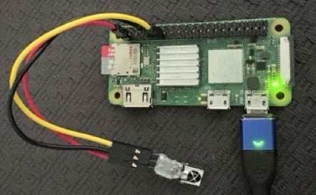

# Barebones IR receiver for Linux

Copyright(c) 2026 BitBank Software, Inc.
Written by Larry Bank 
email: bitbank@pobox.com 
 

 
## How is it different from LIRC?

This is a tiny project that's more of a functional demo than a complete solution. The purpose is to allow you to receive NEC IR codes from any remote control on hand and receive them (in user mode) on your Linux computer with only a 25 cent IR demodulator. LIRC requires a kernel driver and/or specialized hardware. For this project you simply connect an inexpensive IR receiver to any available GPIO pin and you can receive IR codes. The code currently just prints the values to the terminal after each keypress, so it requires some effort on your part to do something useful with that information. 
It polls the GPIO pin for changes in the state of the IR receiver. I added a usleep() in the idle loop so that it uses a tiny percent of CPU time. 
 
If you find this code useful, please consider becoming a sponsor or sending a donation.

